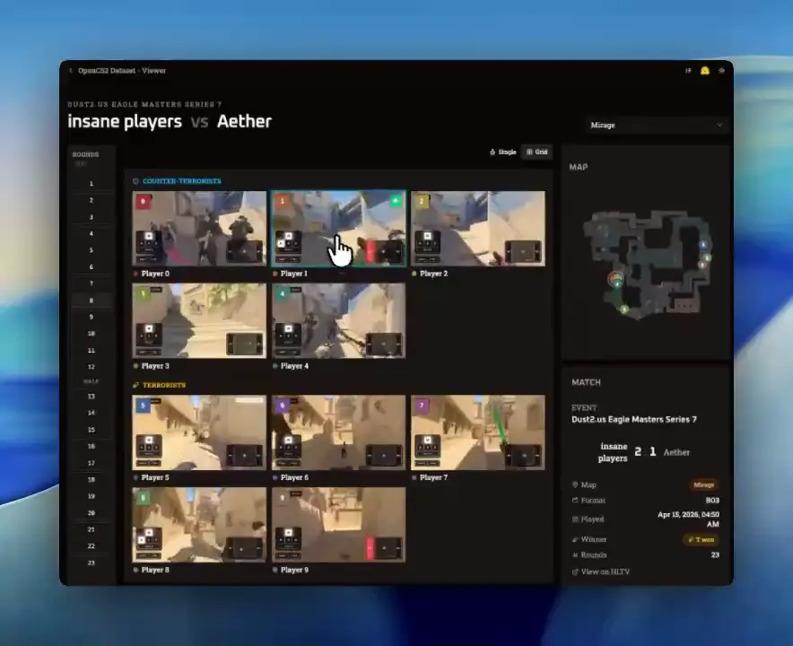

# OpenCS2 Dataset


<p align="center">
  <a href="https://huggingface.co/spaces/blanchon/opencs2-dataset-viewer"><b>🎯 Open the Viewer</b></a> ·
  <a href="https://huggingface.co/datasets/blanchon/opencs2_dataset">Dataset</a> ·
  <a href="https://huggingface.co/datasets/blanchon/opencs2_dataset_wds">WebDataset</a> ·
  <a href="https://huggingface.co/datasets/blanchon/opencs2_dataset_demo">Raw demos</a> ·
  <a href="https://huggingface.co/collections/blanchon/opencs2">Collection</a>
</p>

A rendered dataset of professional Counter-Strike 2 matches. Every round is captured from all ten
player POVs, frame-aligned, with spatialized audio, mouse/keyboard inputs and per-tick world state.
It is built from HLTV demos, served as parquet shards, and browsable online without downloading
the archive.

## Viewer

**[huggingface.co/spaces/blanchon/opencs2-dataset-viewer](https://huggingface.co/spaces/blanchon/opencs2-dataset-viewer)**

Browse every match, map and round, watch all 10 POVs synced on one timeline with the live minimap
and input overlay, and filter the dataset with SQL (DuckDB), all in the browser.

<a href="assets/demo.mp4">
  
</a>

<sub>▶ <a href="assets/demo.mp4">Full demo video</a> · <a href="https://x.com/JulienBlanchon/status/2054519347574350115">Announcement on X</a></sub>

## At a glance

| Matches | Maps rendered | Rounds | POV rounds | POV video |
| ---: | ---: | ---: | ---: | ---: |
| 359 | 794 | 16,527 | 165,270 | ~2,974 h |

The rounds total about 528 hours of game time. Each round is seen from up to 10 POVs, and a
recording stops when that player dies.

## What's recorded

- **Video**: 1280×720 @ 32 fps, near-lossless H.264, one stream per player POV
- **Audio**: per-player stereo, mixed from each player's position and orientation
- **Inputs**: per-tick keystrokes, mouse delta, view angles, fire/jump/use, weapon switches
- **World state**: per-tick positions, velocities, camera intrinsics, health, armor, ammo and
  weapons for all 10 players
- **Events**: kills, duels, clutches, round outcomes and HLTV match metadata
- **G-buffers** *(soon)*: luminance, depth and vertex IDs

Every signal is sampled on the same CS2 tick clock, so there is no drift and nothing to resample.

## What it's for

- **Behaviour cloning / VLA**: `(frame, audio) → action` policies trained on expert play
- **Inverse dynamics models**: recover actions from raw video for VPT-style pre-training
- **World models**: `(frame, action) → next frame`, with 10 POVs of the same world state
- **Spatial-audio conditioning**: localize footsteps and gunfire from per-player stereo
- **Multi-agent training**: all 10 perspectives stay tick-aligned for cooperative or competitive
  policies
- **Multi-view SfM / MVS**: camera intrinsics and poses from 10 synced viewpoints

## Datasets

| Repo | Description |
| --- | --- |
| [`blanchon/opencs2_dataset`](https://huggingface.co/datasets/blanchon/opencs2_dataset) | POV renders: one folder per POV round with `video.mp4` and `ticks.parquet`, plus parquet indexes and event tables |
| [`blanchon/opencs2_dataset_wds`](https://huggingface.co/datasets/blanchon/opencs2_dataset_wds) | The same data as WebDataset tar shards with byte-offset indexes for large-scale training |
| [`blanchon/opencs2_dataset_demo`](https://huggingface.co/datasets/blanchon/opencs2_dataset_demo) | Source HLTV `.dem` files with per-map metadata and analysis |
| [`opencs2-dataset-viewer`](https://huggingface.co/spaces/blanchon/opencs2-dataset-viewer) | The browser viewer for the whole dataset |

Each dataset card has the schemas and loading examples (`datasets`, DuckDB, WebDataset).

## Quick start

Filter with SQL without downloading any video:

```python
import duckdb

duckdb.sql("""
    SELECT match_id, map_name, round, attacker_player_slot, event_seconds, distance
    FROM 'hf://datasets/blanchon/opencs2_dataset/events/kills.parquet'
    WHERE weapon = 'awp' AND noscope AND through_smoke
    LIMIT 10
""").show()
```

## Source code

The generation and rendering pipeline is not public. This repository is the project's home page.

## Acknowledgments

Thanks to the SentientX team for their review and feedback on this dataset, to Hugging Face for the
grant covering dataset hosting, and to RunPod (via [@NERDDISCO](https://x.com/NERDDISCO)) for the
$2,500 compute grant ❤️

## Citation

```bibtex
@misc{blanchon2026opencs2,
  author       = {Julien Blanchon},
  title        = {OpenCS2 Dataset},
  year         = {2026},
  publisher    = {Hugging Face},
  howpublished = {\url{https://github.com/julien-blanchon/opencs2-dataset}},
}
```

## License

Dataset: [CC-BY-4.0](https://creativecommons.org/licenses/by/4.0/).

Counter-Strike 2 is a trademark of Valve Corporation. This project is not affiliated with or
endorsed by Valve.

<p align="center">
  <a href="https://guybrush.ink/">Julien Blanchon</a> · <a href="https://x.com/JulienBlanchon">@JulienBlanchon</a>
</p>
